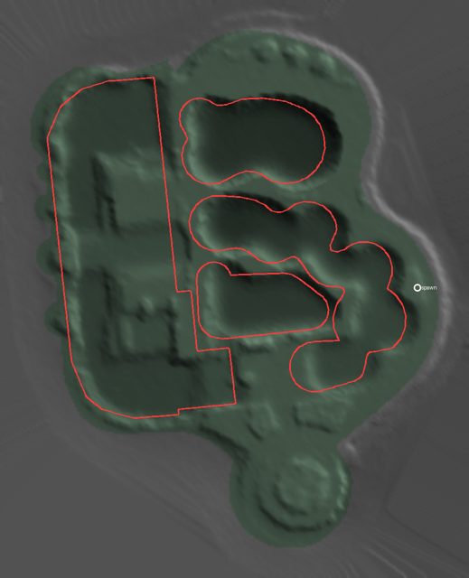
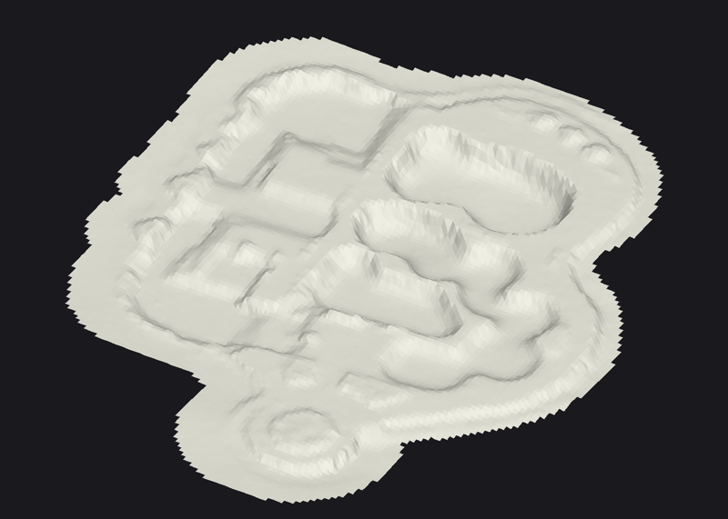
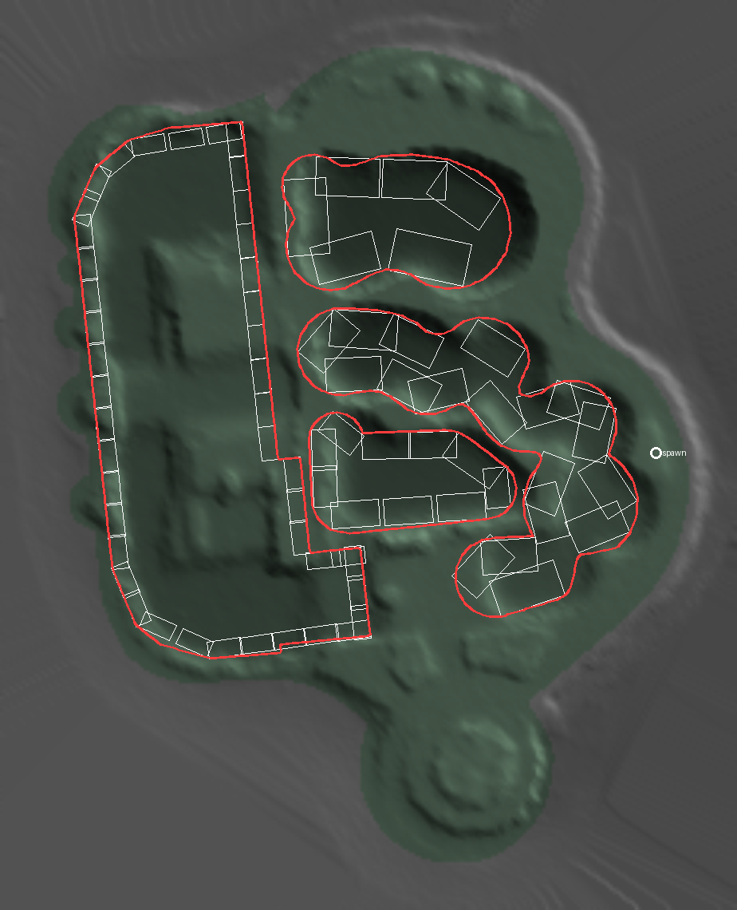

# Example: Venice Beach Skatepark, Los Angeles

A public, much-skated park of bowls and a snake run, measured as its real shape from open data alone.

> The mesh was made for the custom-map route, which this project no longer pursues: it needs
> ReSkate Studio, a third-party tool (CUSTOM-MAPS.md). The park reaches the game as a park mod
> instead (*As a park mod*, below).

```
python -m reskate_lidar city --centre 33.9870851,-118.4754707 --size 120 --skatepark \
    --mesh venice.glb --preview venice.png --report venice.json
python studio_prep.py venice.glb venice.blend          # with Blender's bpy, or: blender -b -P studio_prep.py -- ...
```

The `.glb` and `.blend` are not in git: the command makes them again in about 20 seconds from a
warm cache.

| From above (coping in red, spawn in white; north up) | The collision mesh, from the south-east |
|---|---|
|  |  |

## What the data gives

- **The park:** OpenStreetMap maps it as `leisure=pitch` + `sport=skateboard`, a multipolygon whose holes are the bowls. Each hole's edge becomes a coping grind curve. We read it through Overture's `base/land_use`.
- **The LiDAR:** USGS 3DEP `CA_LosAngeles_1_B23` (2023), the newest of three surveys over it. The 2016 survey has 2.8 points/m². The 2023 survey has 10.7 ground points/m² over the park: about one point every 30 cm. It leaves 3,566 points above the ground (skaters, palms, lamps), and they are dropped.

| Bowl | Area | Depth | Points/m² | Steepest wall in the grid |
|---|---|---|---|---|
| 0 | 114 m² | 1.51 m | 10.8 | 49° |
| 1 | 263 m² | 2.10 m | 12.4 | 53° |
| 2 (snake run and street section) | 599 m² | 0.88 m | 10.4 | 41° |
| 3 | 158 m² | 2.62 m | 11.9 | 60° |

## What comes through, and what doesn't

- **Through:**
  - every bowl's outline, shape and depth to within about a decimetre (the survey's vertical accuracy);
  - the deep ends;
  - the snake run's line;
  - the round feature at the south end.
- **Not through: the coping lip and the top of near-vertical walls.** At 10-12 points/m², a 0.25 m grid smooths the last half metre of a wall: the steepest cells read 49-60°, where the real walls reach vertical. The coping's round lip is a few centimetres across, far under the point spacing. So:
  - **the coping curves are placed from the map's bowl outlines** at deck height, not measured;
  - **the transitions are slightly too mellow** near the top.
- **What a phone scan would add** (CAPTURE.md):
  - the lip and vertical walls at 1-2 cm;
  - the coping's real height and overhang;
  - cracks and the deck's small steps.

  The aerial data still gives the frame and the deck heights around it. Scanning each bowl and merging it into this mesh is the way to a faithful Venice.

## Status

- **Built:** the mesh and the `.blend`. `studio_prep.py` was tested with Blender 4.2's `bpy` and lays out:
  - `Map`: 2 ground tiles, each `sk8_collision_mode = triangle_mesh`;
  - `Grind curves`: 4 coping curves, each `sk8_grind_curve`;
  - `Markers`: `spawn`, on the deck.
- **Not pursued:** compiling it with ReSkate Studio. As a park mod, it is next on the roadmap.

## As a park mod

```
python -m reskate_lidar city --centre 33.9870851,-118.4754707 --size 120 --skatepark \
    --anchor "<Skate>/Mods/Marker/parks/bam.park.json" --mods "<Skate>/Mods" --name "Venice Beach Skatepark" \
    --preview venice-mod.png
```



- **How the bowls are built:** Build Kit objects stand on the base map and can't be sunk into it. So each bowl becomes a ring of quarter pipes rising out of the ground to the bowl's measured depth.
  - Each quarter faces into the bowl, with its coping on the bowl's real coping line (red above).
  - The outline is straightened into runs, and each run is filled with copies.
- **Result:** 78 quarter pipes.

  | Size | Count |
  |---|---|
  | small | 45, round the 0.9 m snake run |
  | medium | 9 |
  | large | 24 |

  - The 2.6 m bowl's quarters stop at 2.4 m, the largest Build Kit quarter.
  - In a narrow bowl the height would be capped to leave a flat bottom. None of Venice's bowls is that narrow.
- **What it gets right:**
  - each bowl's plan and depth;
  - the long straight walls of the snake run.
- **What it gets wrong:**
  - Round ends and lobes are polygons. Quarters that would mostly overlap are left out, so curved walls have gaps.
  - The transitions are Build Kit's, not the real walls' curves.
  - Nobody has checked it in game yet.

## Credits

- **Map data:** © OpenStreetMap contributors, ODbL 1.0 (openstreetmap.org/copyright), through Overture Maps (overturemaps.org).
- **Elevation:** U.S. Geological Survey 3D Elevation Program (3DEP), survey CA_LosAngeles_1_B23, public domain.
